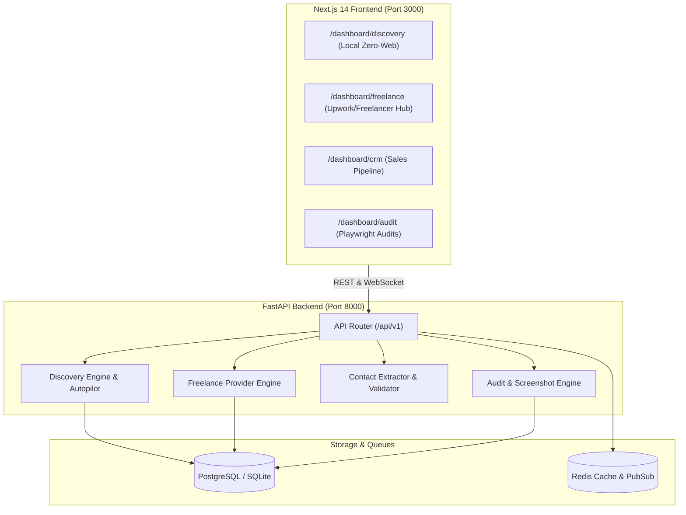

# 🚀 BI Platform — Autonomous Business Intelligence, Zero-Website Lead Engine & Freelance Client Hub

## 📖 Overview

**BI Platform** is an enterprise-grade, full-stack intelligence and outbound sales platform designed for digital agencies, web design studios, freelancers, and growth consultants. It automates client discovery across two high-yield streams:

1. **Local Businesses Without Websites (Zero-Website Leads)**: Mines verified local businesses, boutiques, clinics, restaurants, and social merchants across Instagram, Facebook, Google Maps, OpenStreetMap, Reddit, and E-commerce brands that have active phone/WhatsApp numbers but **no independent website storefront**.
2. **Global Freelance Clients & Hiring Projects**: Continuously streams active paying employers and projects directly from **Upwork**, **Freelancer.com**, and **Fiverr** with verified client budgets and automated AI-tailored 4-step proposal generation.

---

## 🌟 Key Modules & Dedicated Pages

### 1. 🔍 Discovery Center (`/dashboard/discovery`)
- **Auto-Pilot Lead Engine**: 1-click batch discovery across top global commercial markets (Lahore, Karachi, Dubai, Abu Dhabi, Riyadh, Doha, Kuwait, London, New York).
- **24/7 Cruise Mode**: An autonomous background daemon that periodically rotates across niches and cities, filters out dead listings, and feeds qualified leads into your pipeline.
- **Strict Verification Safeguards**:
  - **Live HTTP Domain Probe**: Tests live domain connectivity, DNS, and HTTP redirects (distinguishing actual business domains from social profiles and WhatsApp redirectors).
  - **Aggregator Link-in-Bio Crawler**: Synchronously inspects Linktree, Bio.link, Beacons.ai, and Taplink URLs to check for hidden websites and extract buried mobile contacts.
  - **Mobile Phone & WhatsApp E.164 Normalization**: Validates country dial codes and carrier eligibility.
- **1-Click Multi-Channel Outreach**:
  - 1-Click WhatsApp pitch generator (`https://wa.me/...`).
  - 1-Click Instagram DM launcher.
  - 1-Click Facebook Page Messenger.
  - 1-Click Gmail composer with pre-filled subject and tailored value proposition.

---

### 2. 💼 Freelance Client Hub (`/dashboard/freelance`) — *New Dedicated Page*
- **Live Stream Feeds**: Mined in real-time from Freelancer.com Public API, Upwork, and Fiverr.
- **Exact Client Budgets**: Identifies fixed-price and hourly ranges (e.g. `$1,500 – $12,500 USD`).
- **AI 4-Step Proposal Generator**: Custom-tailored proposals generated per project addressing the client's scope, deliverables, and timeline.
- **1-Click Apply & Copy**: 
  - 1-Click copies the proposal to your clipboard.
  - 1-Click opens the client's direct application page.
  - 100% account safety: zero automated bot-submission bans.
- **Instant CRM Sync**: 1-click bookmarks any project straight into your CRM Deals pipeline with the project value pre-filled.

---

### 3. 🎯 Audit Center (`/dashboard/audit`)
- **10-Dimension Quality Audit Engine**: Scored across UI, UX, Mobile responsiveness, Page Speed, SEO, Accessibility, Security, Content, Branding, and Conversion Architecture.
- **Playwright Headless Screenshot Engine**: Full JavaScript rendering capturing desktop and mobile previews.
- **AI Performance Teardown**: Actionable audit reports generated via Claude API.

---

### 4. 💼 CRM & Sales Pipeline (`/dashboard/crm`)
- Visual Kanban board with stages: `Lead` → `Contacted` → `Audit Delivered` → `Proposal Sent` → `Negotiation` → `Won` → `Lost`.
- Automatic deal creation upon lead discovery with estimated revenue potential.
- Instant contact status tracking.

---

### 5. ⚡ Real-Time Command Center (`/dashboard/command-center`)
- Live WebSocket event stream displaying background discovery batches, domain probes, and contact extraction logs in real-time.

---

## 🔌 12 Data Discovery Providers

| Provider | Target | Source Type | Key Data Extracted |
|---|---|---|---|
| **`freelance`** | Upwork, Freelancer.com, Fiverr | Public API & Live Search | Project title, client budget, scope, direct application link, tailored proposal |
| **`instagram`** | Boutiques, Salons, Bakeries | Bio Crawler & Search | Bio WhatsApp (+92 / international), username, follower count, Linktree probe |
| **`facebook`** | Local Business Pages | Graph & Web Search | Verified business pages, mobile numbers, missing websites |
| **`ecommerce_brands`** | Daraz & D2C Stores | Web & Merchant Scrape | Store tech stack (Shopify/Woo/Custom), verified merchant mobile WhatsApp |
| **`reddit`** | r/forhire, r/freelance, r/ecommerce | Subreddit Post Miner | Direct founder hiring posts, budgets, Discord handles, Reddit DMs |
| **`google_places`** | Global Physical Businesses | Places API (Key-based) | Real address, phone number, rating, review count, website status |
| **`google_maps`** | Worldwide Local Shops | Headless Maps Scraper | Direct Google Maps profile, coordinates, telephone, opening hours |
| **`duckduckgo`** | Web & Directory Leads | Privacy Search API | Business web presence, contact page URLs, email addresses |
| **`overpass`** | Offline POIs | OpenStreetMap Overpass | Real physical POIs without websites (stores, mechanics, tailors) |
| **`nominatim`** | Geocoded Physical Stores | OpenStreetMap Nominatim | City-level physical listings lacking `website` tags |
| **`serpapi`** | Google Local Pack | SerpAPI Proxy | High-ranking local map packs with ratings and reviews |
| **`yelp`** | US & Canada Businesses | Yelp Fusion API | Ratings, phone numbers, price tiers, categories |

---

## 🏗️ Architecture



---

## 💻 Tech Stack

| Layer | Technologies |
|---|---|
| **Frontend Framework** | Next.js 14 (App Router), React 18, TypeScript |
| **Styling & UI** | Tailwind CSS, Framer Motion, Lucide React |
| **State & Data Caching** | TanStack React Query v5, Zustand |
| **Backend Framework** | FastAPI (Python 3.11 / 3.13), Pydantic v2 |
| **Database & ORM** | PostgreSQL 16 (production) / SQLite via SQLAlchemy 2 (async) |
| **Search & Discovery** | Public APIs, DuckDuckGo Search (`ddgs`), BeautifulSoup4, HTTPX |
| **Contact Validation** | `phonenumbers` (Google E.164), `email-validator`, custom Regex engines |
| **Browser Automation** | Playwright (headless Chromium) |
| **Task Queue** | BackgroundTasks (asyncio) + optional Celery / Redis |

---

## ⚡ Quick Start

### 1. Start Backend API
```bash
cd backend
python -m venv .venv && source .venv/bin/activate
pip install -r requirements.txt
uvicorn app.main:app --reload --port 8000
```
*API Swagger documentation available at: `http://127.0.0.1:8000/docs`*

### 2. Start Frontend App
```bash
cd frontend
npm install
npm run dev
```
*Frontend running at: `http://localhost:3000`*

### 3. Open in Browser
- **Freelance Client Hub**: `http://localhost:3000/dashboard/freelance`
- **Zero-Website Discovery**: `http://localhost:3000/dashboard/discovery`
- **CRM Pipeline**: `http://localhost:3000/dashboard/crm`
- **Command Center**: `http://localhost:3000/dashboard/command-center`

---

## 🔒 Ban-Safe Compliance Guarantee

- **Upwork, Freelancer.com & Fiverr**: Strictly compliant. The system discovers opportunities through public feeds and prepares AI proposals in your private dashboard. Submissions are made manually via direct 1-click links, protecting your accounts from anti-bot penalties.
- **Social & Local Scraping**: Uses passive public search and HTTP probes without brute-forcing logins or private sessions.

---

## 📄 License
MIT License. Built for autonomous client discovery and outbound lead conversion.
